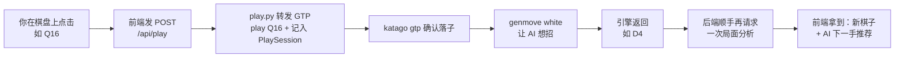
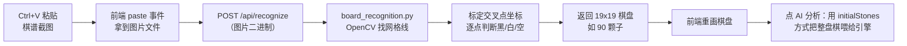
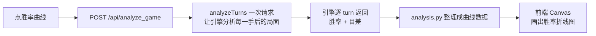
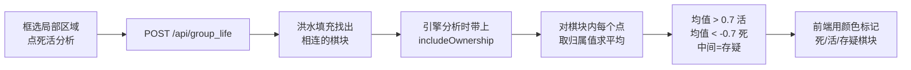

# Go AI 程序架构文档

> 一句话总览：**浏览器里的棋盘界面 + 一个 Python 小服务器 + 两个 KataGo 引擎进程**，三个部分各司其职，通过 HTTP 和文本/JSON 协议串联起来。
>
> 服务端已按业务线拆分：**对弈线（play.py）与分析线（analysis.py）数据零耦合**，各自管理各自的状态；server.py 只做路由分发，不含任何业务逻辑。


---

## 一、整体架构：三层结构

### 第 1 层：浏览器层（index.html，单页应用）

整个前端就**一个 HTML 文件**，没有 React/Vue，没有构建工具，纯手写 JavaScript + Canvas。打开 `http://localhost:8080` 就加载它。

它负责四件事：

1. **画棋盘**：用 Canvas 逐像素画出 19 路棋盘网格、黑白棋子、星位、最后一手标记。棋盘坐标从 `ABCDEFGHJKLMNOPQRST`（跳过 I，围棋惯例）映射到像素，边距 30px，格距约 31px。
2. **对弈界面**：「对弈」Tab 里放落子、悔棋、 Pass、开始新对局、申请 AI 让子等按钮。
3. **分析界面**：「局面分析」Tab 展示当前局面的胜率、目差、AI 推荐的前 5 个候选点，另有胜率曲线图、粘贴截图识别、局部死活判断、AI 解说等功能。
4. **本地存档**：用 localStorage 保存棋谱记录，刷新页面不丢。

前端自己不思考，**所有"聪明"的活都甩给后端**——它只管画图和发 HTTP 请求。

**两条业务线的边界规范**：对弈 Tab 与局面分析 Tab 在前端就是两套独立状态（`moveHistory` vs `analyzeBoard`/`analyzeMoveHistory` 等 `analyze*` 变量），模块之间不读对方的变量；唯一的合法通道是用户显式操作（把对弈局面"导出"到分析面板时的快照拷贝）。此外前端所有异步分析请求都带**竞态令牌**（`analyzeStatusSeq`），过期响应（如迟到的识别回调）直接丢弃，不会污染当前画面。

### 第 2 层：服务层（server.py + play.py + analysis.py + common/）

后端只**用 Python 标准库**，没有 Flask/Django——`server.py` 里的 `ThreadingHTTPServer` 监听 8080 端口，每来一个请求开一个新线程。服务层内部按业务线拆成四块：

**server.py —— 路由表 + 启动（约 150 行）**

一张 `POST_ROUTES` 字典把路径映射到业务函数：对弈线 7 个接口、分析线 6 个接口，一眼看全。它自己不含任何业务逻辑，只做分发、异常兜底和静态文件托管。入口兼容：`python app.py` 和 `./start.sh` 都能启动（app.py 现在只是个兼容壳，内部调用 server 的 main）。

**play.py —— 对弈业务线（状态自持）**

- `KataGoEngine`「GTP 管家」：管负责下棋的 KataGo 进程。GTP 是围棋引擎的通用文本协议，一来一回像发电报：发 `genmove B`，引擎回复 `D4`。落子、悔棋、Pass、设置贴目都走这条路。
- `PlaySession` —— **对局状态唯一真相源**：着法历史在后端与 GTP 引擎同步记录。悔棋不再是"盲撤两手"，而是**截断历史 + 空盘 + 全量重放**，即使中间有 Pass、认输、载入棋谱，后端引擎状态与前端棋盘也永不分叉（兼容旧客户端：不带 `keep` 参数的请求仍走旧行为）。

**analysis.py —— 分析业务线（无状态查询）**

- `KataGoAnalysisEngine`「分析管家」：管负责分析的 KataGo 进程。这个进程不下棋，接受 JSON 格式的分析请求，返回每一手棋的胜率、目差、候选点排名等数据。它有一把**全局线程锁**：一次只算一个分析请求，后来的排队。
- **过期淘汰**：每个分析请求带一个递增的 ticket；排队时若来了新请求，被超过的旧请求拿到锁后直接返回 `superseded`，不占算力——连点多次"AI 分析"永远只算最后一次。
- **双路径选择在后端裁决**：分析请求同时带 `setup_stones`（摆子/截图识别）和 `move_history`（有落子顺序）时，由后端统一决定走哪条路（有摆子必走 initialStones，否则走落子历史），前端不感知这条规则。
- 工具集：`board_recognition.py`（OpenCV 截图识别）、规则式/LLM 中文讲解（配置 `GOAI_LLM_*` 环境变量后可调大模型，没配就回退模板）。

**common/ —— 公共基座（纯工具，无业务）**

`katago_base.py`（子进程启动/崩溃自动重启，两个引擎继承同一个基类）、`coords.py`（GTP 坐标转换）、`sgf.py`（棋谱解析）。

### 第 3 层：引擎层（两个 KataGo 子进程）

KataGo 是世界顶级的开源围棋 AI 引擎，这里用的是 **v1.16.4 + Metal GPU 加速**（Apple M2 Pro 芯片），两个进程**共享同一个神经网络模型文件**（约 271MB 的 b28c512 大网络）：

- `katago gtp` —— **棋手**：专心下棋，走 GTP 文本协议；
- `katago analysis` —— **军师**：专心分析，走 JSON 行协议（一行请求、N 行结果）。

### 两条核心设计

**设计一：双业务线数据零耦合。** 对弈与分析是服务两个场景的两条独立业务线，各自持有各自的状态（对弈=PlaySession+GTP 引擎局面；分析=每次请求全量携带局面快照）。二者之间没有共享的可变状态，界面间唯一通道是用户显式导出。改对弈不会碰坏分析，反之亦然。

**设计二：双引擎职责分离。** 为什么要开两个进程而不是一个？因为两种协议的模式完全不同：对弈要的是**快**（一次一招，1 秒内出结果），分析要的是**深**（一次算几百种变化，动辄十几秒）。如果混在一个进程里，你问"这局面胜率多少"的十几秒里，AI 就卡住不能下棋了。拆开之后，**分析在排队，棋照下；棋在思考，分析结果照样慢慢算**，互不阻塞。

---

## 二、四条核心数据流（一次点击背后发生了什么）

### 流程 1：人机对弈——你落一子，AI 回一子



你在棋盘上点一下，前端把坐标 POST 给 `/api/play`。后端先用 GTP 的 `play` 命令把你的棋告诉引擎，同时记入 PlaySession，再发 `genmove` 让引擎思考出下一手。引擎回复坐标后，后端还会**顺手请求一次分析**，把"AI 认为的最佳下一手"一并返回给前端——这样你落完子，界面上立刻就能看到 AI 的推荐标记，不用再点一次分析。

悔棋（`/api/undo`）带 `keep` 参数：后端把 PlaySession 的历史截断到保留手数，清空引擎棋盘后全量重放——无论之前是正常落子、Pass 还是认输，重放后的引擎状态都和前端棋盘严格一致。

### 流程 2：粘贴截图识别（Ctrl+V 复盘神器）



从网页或看棋软件复制一张截图，直接 Ctrl+V 粘贴。前端监听 paste 事件，把图片原样发给 `/api/recognize`。`board_recognition.py` 用 OpenCV 先找到棋盘的网格线（自动标定 19 条线的位置），再逐个交叉点判断是黑子、白子还是空点，返回一整份数字棋盘。前端据此重画棋盘。

之后点「AI 分析」时有个巧妙细节：因为截图识别**不知道落子顺序**，所以走的是 `initialStones`（初始棋子）路径，把整盘棋当作"摆好的死局面"来分析；而正常对弈的棋谱知道每手顺序，走 `move_history`（落子历史）路径，引擎能利用历史信息算得更准。**选哪条路由后端的 `_select_query_path` 统一裁决**（有摆子必走 initialStones），前端只管把两种数据都带上。

### 流程 3：整局胜率曲线



看整盘棋哪一手开始崩盘，就靠这个。它用了 analysis 引擎的 `analyzeTurns` 功能：**一次请求，让引擎把每一手棋之后的局面都分析一遍**，返回一连串胜率数据，前端画成折线图。你一眼就能看到胜率"跳水"的那一手。

### 流程 4：局部死活判断（这块棋是死是活？）



想知道被围住的一块棋还有没有救，就框选它。后端先用**洪水填充算法**找出你框选区域里相连的棋块，再请求分析时让引擎输出 `ownership`（每个交叉点归属哪方的评估值），对棋块内所有点的归属值取平均：平均接近 +1 说明基本是黑棋的活棋，接近 -1 说明已经是白棋的囊中之物，中间地带标记为"存疑"。

---

## 三、文件清单：每个文件是干嘛的

| 文件 / 目录 | 角色 | 一句话说明 |
|---|---|---|
| `index.html` | 前端 | 全部界面逻辑：画棋盘、发请求、画图表，单文件单页应用；对弈/分析两套独立状态 + 竞态令牌 |
| `server.py` | 后端入口 | 路由表分发（POST_ROUTES）+ 静态文件 + 启动检查，不含业务逻辑 |
| `play.py` | 对弈业务线 | KataGoEngine（GTP 管家）+ PlaySession（对局状态唯一真相源）+ 对弈 7 个接口 |
| `analysis.py` | 分析业务线 | KataGoAnalysisEngine（分析管家，全局锁+过期淘汰）+ 截图/SGF/讲解/死活 6 个接口 |
| `common/` | 公共基座 | katago_base.py 子进程基座 · coords.py 坐标 · sgf.py 棋谱解析（纯工具无业务） |
| `app.py` | 兼容壳 | 仅 `from server import main`，保证 `python app.py` 旧命令仍可用 |
| `board_recognition.py` | 前端帮手 | OpenCV 截图识别：网格标定 + 交叉点分类 |
| `katago` | 引擎可执行文件 | KataGo v1.16.4 主程序（Metal GPU 版） |
| `*.bin.gz` | 神经网络模型 | 约 271MB 的 b28c512 大网络，两个引擎共享 |
| `gtp.cfg` | 引擎配置 | 对弈引擎的参数（搜索线程数、缓存等） |
| `analysis.cfg` | 引擎配置 | 分析引擎的参数（单分析线程 × 24 搜索线程等） |
| `start.sh` | 启动脚本 | 用专用 Python 运行时启动 server.py，保证依赖齐全 |
| `logs/` | 日志 | 引擎的标准输出/错误日志，排查问题第一现场 |
| `tests/` | 测试 | 各功能端点的自动化测试脚本（全部 HTTP 黑盒，不 import 后端模块）+ 测试计划 |

---

## 四、设计要点与几个值得知道的"坑"

**1. 为什么不用 Web 框架？**
整个应用只有一个页面、十来个接口，标准库的 `ThreadingHTTPServer` 完全够用。零依赖意味着 `start.sh` 一跑就能起来，不装任何包（除了识别功能的 OpenCV）。

**2. 全局锁 + 过期淘汰：分析请求排队且只算最新的**
`KataGoAnalysisEngine` 上有一把全局线程锁。多个浏览器标签页同时点"AI 分析"不会报错，但会**排队**——一个算完才算下一个。这是刻意为之，因为 GPU 就一块，让两个搜索同时抢反而都变慢。在此基础上，每个 `/api/analyze` 请求带递增 ticket：排队时来了新请求，旧请求拿到锁后直接返回 `superseded` 不占算力，所以**快速连点永远只算最后一次**，响应也不会乱序覆盖（前端还有竞态令牌兜底）。

**3. 悔棋为什么是"截断+重放"而不是撤两手？**
GTP 引擎自己不维护可靠的历史（undo 在 pass、认输等场景下会与前端棋盘分叉）。PlaySession 在后端同步记录每一手，undo 时截断历史、清空棋盘、逐手重放，保证引擎局面与前端显示**永远一致**。不带 `keep` 的旧请求保持原有兼容行为。

**4. 胜率视角统一为黑棋**
引擎配置了 `reportAnalysisWinratesAs=BLACK`，所有胜率、目差统一以黑棋视角报告。前端如果发现当前轮到白棋走，会自动把胜率翻转成"白棋视角"再显示——所以你看到的数字永远站在"即将落子一方"的立场上。

**5. Python 环境依赖坑（上次 bug 的根因）**
图像识别依赖 OpenCV（cv2）和 numpy。如果用系统里另一个没有这些包的 Python 启动服务，`board_recognition` 会静默导入失败，粘贴截图时就会报"图像识别模块不可用"。现在的修复是：导入失败时自动去专用运行时的 site-packages 里找同版本的包再试一次。**最保险的做法永远是用 `./start.sh` 启动**。

**6. 截图识别后要等"识别完成"**
粘贴截图后识别有几秒耗时（OpenCV 处理），期间棋盘还是空的。要等状态栏提示识别完成、棋子画出来之后，再点"AI 分析"。

**7. 引擎日志是排查问题的第一现场**
KataGo 对不认识的 JSON 字段、非法坐标等都会在 stdout 打警告（比如曾经误传的 `includeMoveInfos` 字段）。遇到分析结果异常，先看 `logs/` 里的引擎日志有没有 warning。

---

## 五、一张图记住这个程序

```
 你的浏览器                  server.py (路由表, 8080)              两个 KataGo 进程
┌──────────────┐   HTTP    ┌─────────────────────────────┐  GTP文本  ┌─────────────┐
│  index.html  │ ──对弈──▶ │ play.py  对弈线(状态自持)     │ ────────▶ │ katago gtp  │
│  画棋盘/图表  │           │   KataGoEngine + PlaySession │           │  （棋手）    │
│              │           ├─────────────────────────────┤           ┌─────────────┐
│  Ctrl+V 截图 │ ──分析──▶ │ analysis.py 分析线(无状态查询) │  JSON行   │   katago    │
│  localStorage│           │   分析管家(锁+过期淘汰)+识别   │ ────────▶ │ analysis军师│
│              │           │ common/ 基座·坐标·SGF(纯工具) │           └─────────────┘
└──────────────┘           └─────────────────────────────┘   共享同一个 271MB 神经网络模型
```

记住三个关键词就够了：**双业务线零耦合、零依赖后端、双引擎分离**。
